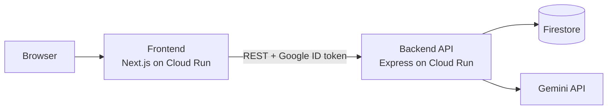

# Kairos Bible

**Read, compare and study the Bible with AI.** Live at **[kairos-bible.com](https://kairos-bible.com/)**

> Plataforma web para leer, comparar y estudiar la Biblia con inteligencia artificial, en español e inglés.

<!-- Add 2-3 screenshots here: home, reader, AI chat -->

## Features

- **Bible reader** with multiple translations, book/chapter navigation and reader settings
- **Side-by-side comparison** of a verse across translations
- **AI study tools**: chat, verse explanation and translation comparison, powered by Google Gemini
- **Google sign-in**, bookmarks, notes and reading history
- **Full-text search** across the Bible
- **Bilingual UI** (Spanish / English), light and dark themes
- SEO sitemap, legal pages and non-intrusive ads

## Architecture



- **Frontend**: Next.js 16, React 19, TypeScript, Tailwind CSS, shadcn/ui
- **Backend**: Node.js, Express 5, Firebase Admin (Firestore), Google Gen AI SDK
- **Auth**: Google Identity; the backend verifies the ID token before any AI call
- **Infra**: Docker (multi-stage builds), Google Cloud Build, Cloud Run

### How the AI layer works

Each request picks a model profile based on the task, balancing cost and quality:

| Profile | Used for | Primary model | Max output |
|---|---|---|---|
| Chat | Quick questions | Gemini 2.5 Flash-Lite | 512 tokens |
| Brief | Short verse explanations | Gemini 2.5 Flash | 768 tokens |
| Deep | In-depth study | Gemini 2.5 Pro | 2048 tokens |

If the primary model fails, the backend retries and falls back to a lighter model. A concurrency limit keeps API usage under control. All of this is configurable through environment variables.

## API

| Method | Endpoint | Description |
|---|---|---|
| GET | `/health` | Service status |
| GET | `/api/bible/translations` | Available translations |
| GET | `/api/bible/books` | Book list |
| GET | `/api/bible/books/:bookId/chapters/:chapter` | Chapter text |
| GET | `/api/bible/compare/:bookId/:chapter/:verse` | One verse in every translation |
| GET | `/api/bible/search` | Text search |
| GET | `/api/me/history` | User reading history (auth) |
| POST | `/api/chat` | AI chat, explain and compare (auth) |

## Run locally

```bash
# Frontend
pnpm install
NEXT_PUBLIC_BACKEND_URL=http://localhost:8080 pnpm dev

# Backend
cd backend
npm install
GEMINI_API_KEY=... GOOGLE_OAUTH_CLIENT_ID=... npm start
```

## Deploy

Custom Node scripts package the source, build the image with Cloud Build and deploy it to Cloud Run through the Google Cloud REST APIs:

```bash
npm run cloud:deploy:backend
npm run cloud:deploy:frontend
npm run cloud:status
```

## Author

**Juan Felipe Ocampo Pinzón**: [LinkedIn](https://www.linkedin.com/in/juan-felipe-ocampo-pinz%C3%B3n-59a31120b) · [GitHub](https://github.com/juanfelipeocampopinzon)
